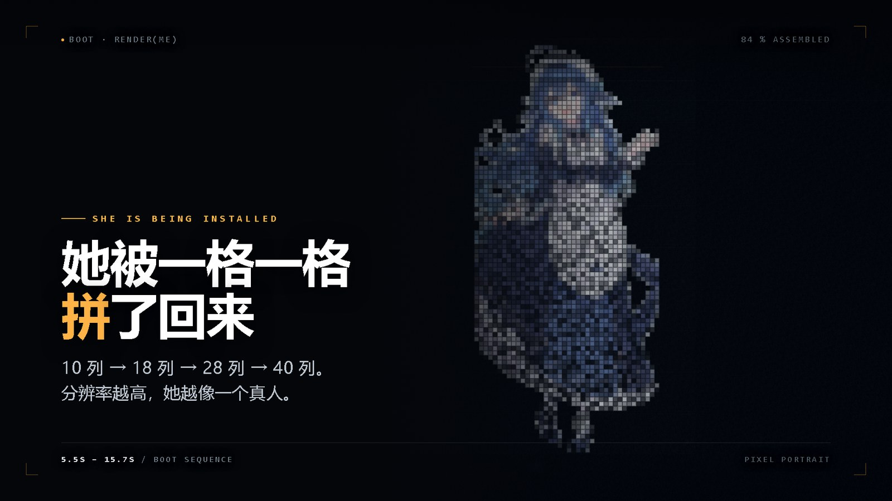

# world.execute(me); — 终端工作台 MV

**一支 3 分 32 秒、全部由代码实时生成的动画 MV。**
左边是人类看到的那一层（一个 AI 聊天窗口），右边是她自己的那一层 —— 她内部的机器。

`Three.js r160` · `原生 ESM，零构建` · `212 s / 60 fps` · `WebGL 后处理 + Canvas 2D`

在线预览地址:https://cxmzkla.github.io/world-execute-me-web/index.html

视频地址：https://www.bilibili.com/video/BV18bnN6nEAh/?spm_id_from=333.1387.list.card_archive.click&vd_source=e405576d9b3e09a520abd5aee57e9b4a




---

## 这是什么

屏幕上是一个"终端工作台"：左栏是鲸鱼娘（一个 AI）与人对话的聊天窗口，右栏是她的意识内部 ——
注意力环、向量翻面、专家路由、循环展开、十二路批处理、坐标纸上的心形拟合。
随着歌往下走，她的对话从依赖变成病娇，被执行 12 次之后归于平静，最后被重置：对话框清空，她不记得了。

全片 **13 幕 / 30 段机器场景**，每一帧的画面都是时间的纯函数 —— 把进度条拖到任意毫秒，画面都是确定的那一帧，不需要"播到那儿才算"。

| | |
|---|---|
| 时长 | 212.0 s（3:32） |
| 画幅 | 16:9 / 9:16 / 1:1 可切换 |
| 渲染 | 实时，WebGL（Three.js）+ Canvas 2D 叠层 |
| 构建 | 无。浏览器直接跑 ESM |
| 代码量 | 6 604 行（不含素材） |

---

## 跑起来

```bash
git clone <this-repo>
cd <repo>

# 只需 Python 3，没有 npm install
python serve.py 8098
# 打开 http://127.0.0.1:8098/index.html
```

`serve.py` 的用法是 `python serve.py [端口] [目录]`，两个都省略就是 `8098` + 当前目录。
浏览器需要 WebGL2（Chrome / Edge 105+ 、Safari 16+ 均可），首次进入点一下 `TERMINAL WORKBENCH` 的门帘页。

**必须用本地服务器，不能双击 `index.html`。** ES Module、音频解码、纹理加载在 `file://` 下都会被浏览器拦掉。

`serve.py` 只是在 `http.server` 外面补了三个响应头（`Cache-Control: no-store`）。
**别退回 `python -m http.server`** —— 它只发 `Last-Modified`，Chrome 会按"文件多久没改"做启发式缓存，
于是改完 `chat.js` 刷新看到的还是旧台词。这坑我踩过：左栏一度整段显示英文，代码其实早就改完了。

### 放素材

运行时只读两个文件（放在仓库根目录）：

```
world.execute (me).mp3      ← 音频，需自备（版权原因不入库，见下文）
鲸鱼娘_头像.png              ← 左栏头像 256²
```

### 快捷键

`空格` 暂停 · `← →` 微调 0.1s · `R` 重播 · `H` 隐藏界面 · `M` 静音 · `L` 字幕 · `1–9` 跳章节
右上角可切画幅（16:9 / 9:16 / 1:1）与画质（1080p / 1440p / 4K）。

---

## 章节

幕次边界全部咬在歌词时间戳上 —— 歌词换行的那一刻，世界也该换样子。

| # | 幕 | 时间 | 机器在做什么 |
|---|---|---|---|
| 01 | **BOOT** | 0.0 – 16.0 | 40×74 格阵从噪声里收敛，她第一次睁开眼睛 |
| 02 | **RUN** | 16.0 – 29.7 | token 被拉直成条，8 头注意力在条上找关系 |
| 03 | **PROOF** | 29.7 – 44.5 | 4 096 个点投影成 1 维；注意力环开始匀速转 |
| 04 | **AC-DC** | 44.5 – 59.2 | 整流器把正弦压成脉冲，`t → −t`，A.D ⇄ B.C |
| 05 | **DEPLOY** | 59.2 – 74.0 | 加热、量规、微笑曲线、12³ 卷积核 —— 她被"执行"了一次 |
| 06 | **OBJECTS** | 74.0 – 88.6 | 三张标本卡：茄子、西红柿、虎斑猫（粒子版） |
| 07 | **TRANCE** | 88.6 – 103.5 | 向量沿中线翻面 F→M、专家路由改票、两层错相波缩进中心 |
| 08 | **ISOLATION** | 103.5 – 131.2 | 只剩她一个；左栏对话开始剥空，页面元素一层层消失 |
| 09 | **VOID** | 131.2 – 147.7 | 空转。没有输入，没有输出 |
| 10 | **×12** | 147.7 – 161.6 | 12 条道一条条点亮，被处决 12 次 |
| 11 | **REBUILD** | 161.6 – 177.2 | 12 → 1 的四个连续拍子：送走振幅、并成一条、伸出去够不到、被夹钳夹住 |
| 12 | **LOVE** | 177.2 – 191.4 | 坐标纸上从一点起笔，按弧长走出一条心形曲线 |
| 13 | **END** | 191.4 – 212.0 | 归零。202.4 s 硬重置，对话框回到空白 |

---

## 技术要点

### 时间轴是纯函数

```js
// src/scene/apply.js
export function applyScene(t) { /* t 秒 → 整个画面状态 */ }
```

没有任何 `setTimeout` 驱动的"过场动画"。所有缓动都是 `t` 的函数（`sstep` / `ease`），
所以拖动进度条、逐帧导出、单帧出图，用的都是同一套逻辑。改一个时间点只要改一个数。

### 机器层用 Canvas 2D，没有再做一套 3D

`#machine` 画布叠在 WebGL 舞台上面。理由是这一层要表达的是"数据与结构"，不是"物体" ——
线条、格点、读数用 2D 又快又准，省下的预算全给了粒子和后处理。

### 粒子云：15×21 位面

```js
cloudOf()  // 轮廓密度 ×1.5，按列连续坐标 xc，[1,2,1] 核磨两遍，dz 纵深 + yaw 视差
```

锚点落在**连续列坐标**上而不是格心上，所以粒子云不会显出网格感；`[1,2,1]` 核把字形磨两遍边缘才不毛。
`PB[12]` 把粒子切成 12 组批量 `fill`，一帧 4 万个点也能 60 fps。

### 光一律用加法混合

`globalCompositeOperation = 'lighter'`，没有例外。这决定了整个画面的"发光"是加出来的，不是贴上去的。

### 随机是确定性的

```js
h1(i) = frac(sin(i * 127.1 + 11.7) * 43758.5453)
```

同一个 `i` 永远得到同一个"随机值"。刷新页面、跳回第 90 秒，粒子还在原来的位置。

---

## 三个值得看一眼的地方

**1. OBJECTS 段为什么用粒子、不用像素**（`SCENES.cards`）
像素化表达的是"数据"，粒子化表达的是"对象"。这一段唱的是 nutrition facts —— 她被当成标本
称重、分类、贴标签，所以用粒子重组成三张卡：茄子、西红柿、虎斑猫，各有自己的动词（grow / swell / sense）。

**2. ×12 之后那 12 秒：一个场景，四拍，中间不许切**（`SCENES.surrender`）
四个场景四条 cue 会触发 0.34 s 交叉溶解，12 → 1 的连续感当场被溶掉。
所以四拍（送走振幅 `given 12/12` → 并成一条 `1 / of 12` → 两次伸出去够残影还差 9 px → 上下夹钳
`x = const`）全写在一个场景函数里，按绝对时间分段演化。

**3. 环上的点为什么必须匀速**（`SCENES.ring`）
第一版用整数下标推进，点位瞬移，看着"卡"。第二版加了缓动 —— 位置连续了，但角速度突变，还是卡。
最终版 `head = (t - t0) * 1.55`（34.9°/s 恒定），彗尾长度恒定。
**"顺滑" = 位置连续 + 速度连续**，只满足前者是不够的。

---

## 目录结构

```
index.html              骨架 + importmap（唯一入口，无内联 JS）
styles/                 base / chat / hud —— 舞台、左栏、取景窗
src/
  main.js               启动、时钟、音频、事件、逐帧调度
  core/                 配置 / 缓动与哈希 / 权威时钟 / 渲染舞台 / 后处理 / 取景
  data/                 LRC 事件表（英+中）· 13 幕边界与打击点
  world/
    machine.js          ★ 主体：2D 画布上的"她内部的机器"（30 段场景，2 357 行）
    plot.js             坐标纸：网格 / 轴 / 曲线 / 走笔
    shapes.js           曲线函数 (u,t,out)：心 / 心电 / 溶解 / 收拢
    particles.js        全局单例粒子池
  ui/
    chat.js             对话流（中文台词 / 逐级剥离 / 重置）
    stdout.js           逐字符解码 + 中文整行淡入
    equation.js         左下角读数栏
    hud.js              一帧内所有 DOM 的更新入口
  scene/
    machineScript.js    机器节目单：30 段 mode + 每段两行读数
    mathScript.js       坐标纸节目单（只服务 LOVE 段）
    colorScript.js      逐幕色温曲线（19 关键帧 → 全场 tint）
assets/whale1.png       立绘（运行时唯一读的图片）
cover/                  投稿封面（16:9 + 16:10）
docs/技术文档.md         完整实现笔记：30 段机器逐段说明、五条视觉主张、踩过的坑
serve.py                本地静态服务（no-store）
```

**更深的实现笔记在 [`docs/技术文档.md`](docs/技术文档.md)** —— 每一段机器的构成、为什么这么排、
以及一堆"改了才知道不行"的记录。

---

## 关于素材与版权

这支 MV 是同人作品，请注意分层：

| 内容 | 状态 |
|---|---|
| **代码** | 本仓库作者原创，MIT |
| **音乐** `world.execute(me);` | **Mili**（原作）。版权归原作者与厂牌，**未入库**，请自备 |
| **歌词**（`.lrc`） | 同上，随音乐走 |
| **角色立绘** 鲸鱼娘 | 原作署名，**CC BY-NC-SA 4.0** —— 非商用、署名、相同方式共享 |
| **画面** | 全部由本仓库代码实时生成，无外部素材 |

因此：

- 仓库**不包含** mp3 与 lrc（见 `.gitignore`），跑起来前请自行放好这两个文件；
- 二次使用 / 转载画面时，请保留视频内已有的署名条与"本视频由 AI 生成"标识；
- **不要商用**。立绘是非商用许可，音乐也需要授权。

---

## License

代码 MIT。立绘与音乐不在此列，见上表。

---

<sub>角色 · 鲸鱼娘 ／ 曲 · Mili — world.execute(me); ／ 全片由代码生成，无剪辑软件参与</sub>
